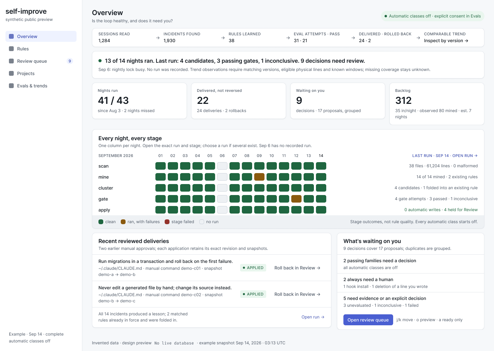
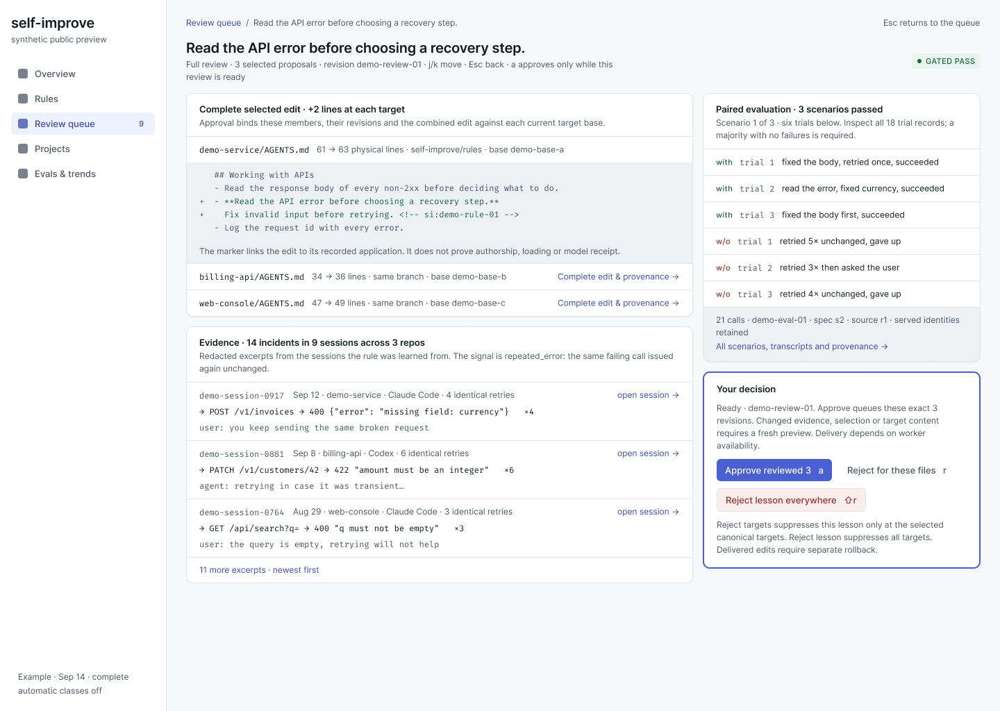
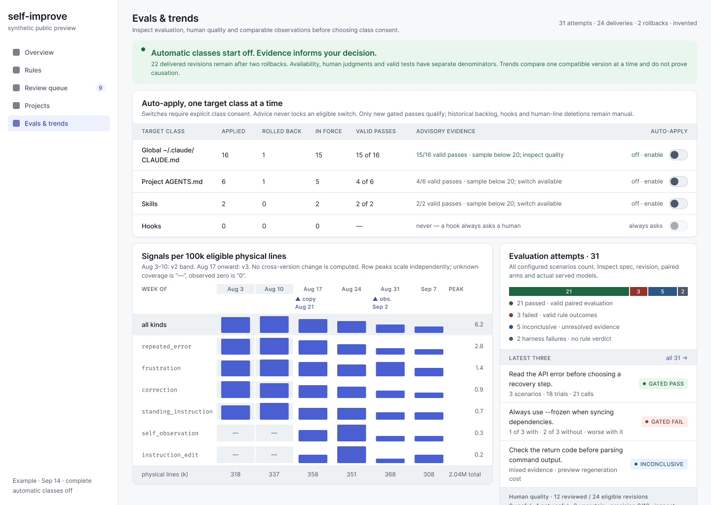
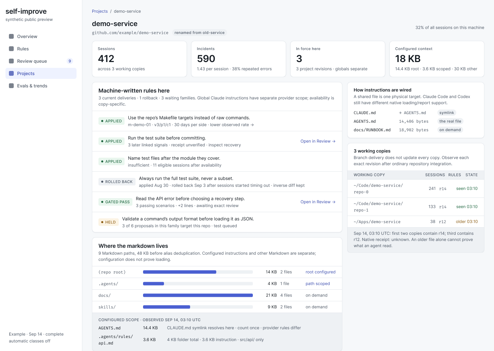
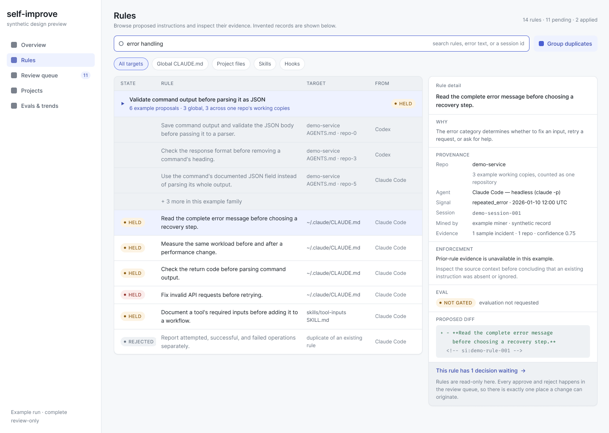

# recursive-self-improve

**A research preview for turning recurring coding-agent mistakes into reviewable instruction changes.**

The tool reads saved Claude Code and Codex sessions, identifies mistakes and
corrections, and proposes changes to agent instructions. A local dashboard lets
you inspect runs, rules, evidence and proposed edits. The research question is
whether feedback from earlier agent work can improve instructions for later work.
No general improvement rate is claimed.



*Overview — Figma v2 design with invented data. The pipeline, stage history, and
review queue show how the pieces fit together.*

The images below are **Figma design exports** with invented examples, taken from
the reconciled v2 design. Their counts, trends, and trial outcomes are
illustrative. The dashboard implements this v2 design, so the disposable demo
shows the same screens. Complete visual parity is not claimed, and the demo does
not match these exports pixel for pixel. See
[preview scope](docs/RESEARCH_PREVIEW.md) for implemented behavior.

## Try it without personal history

Install Python 3.12 or newer, Git and [uv](https://docs.astral.sh/uv/). Then:

```sh
uv sync --extra dashboard --frozen
uv run python examples/dashboard_demo.py
```

Open **http://127.0.0.1:8876**. The real dashboard uses an invented dataset in a
temporary directory. It makes no model calls and reads no personal history.
Decisions affect only that disposable database. Stop with Ctrl-C; the next
launch starts fresh.

The separate retrieval demo uses the pinned public embedding model:

```sh
uv run selfimprove eval-retrieval --synthetic --json
```

The first retrieval run downloads the model; embedding then runs locally.
Synthetic scores exercise the harness and do not establish real-history quality.
See [installation and package checks](docs/DISTRIBUTION.md).

## Supported workflow

Version 0.1.3 separates where an edit is written from where an agent reads it,
through an optional `[targets]` table, and routes personal or machine-specific
lessons to the private rules file you name as `[targets] global_private`. Without
that target, routing refuses a personal lesson. Instruction files in folders listed
in `instruction_excluded_dirs` are never read, and routing offers no new
destination there. Folders match by path text, without following symlinks. A
proposal created before a folder was excluded can still be approved and written.
A corrected-target recovery can now deliver a lesson into an existing skill. The
release also adds an opt-in pre-mining filter benchmark (`eval-filter`), a
scope-routing check (`eval-scope`), an optional gated deployment job, and fixes
and added tests for about fifty findings from a code audit, including stricter
redaction rules.
See [delivery targets](docs/TARGETS.md), [the example
configuration](examples/config.example.toml), [the filter
benchmark](docs/EVAL_FILTER.md) and [gated deployment](docs/DEPLOYMENT.md).

Version 0.1.2 rebuilt every screen on the v2 design and added a full Review
detail view, a command palette, grouped project navigation, and Run backlog and
delivery context. It records observational recurrence measurements, human quality
judgments, display-only rule families, retained instruction text, and native
session and loading reports for both Claude Code and Codex. Instruction
inventories now also cover legacy commands, managed files, embedded policy, and
plugin instructions. Evaluation details retain the frozen rule, scenarios, trial
outcomes, and served models.

These records support inspection. A retained report does not establish that an
agent loaded or followed a rule, and a recurrence measurement is an association,
not a cause. No improvement rate is claimed. Existing installations need the
[database upgrade](docs/UPGRADING.md).

Inspect runs, rules and evidence; review the exact proposed revision; approve it;
run the instruction worker explicitly; inspect its result; and request a
conflict-aware rollback. Scoped rejection can suppress one target or a lesson.
Automatic classes start off. Review decisions alone do not write instruction files.



*Review detail — inspect the combined edit, its source evidence, and example trial
outcomes together, then approve or reject it for these files or everywhere.*

[The workflow guide](docs/WORKFLOW.md) explains explicit delivery, stale previews,
retries, rejection and rollback. Project delivery may create a commit on its
recorded delivery branch rather than change the checked-out file.

## Evals & Trends



Each automatic target class starts off, and its switch shows evidence as advice
rather than a threshold that unlocks it. Compare signal rates per 100,000 eligible
lines within one detector version, then open an evaluation to inspect its source
rule, scenarios, paired trials, and served models. Review historical outcomes and
missing coverage before deciding whether to test a rule again.

*Figma v2 design preview with invented data; trends and example verdicts do not
establish real-world improvement.*

## Follow instructions across working copies

The Project page brings together sessions, linked lessons, instruction inventories,
and recorded rule availability. Working copies share one repository identity.



*Project detail — Figma v2 design showing example instructions, file links, and
working copies. The examples do not establish that an agent read or followed a rule.*

<details>
<summary>More: Rules browser and evidence inspector</summary>



*Rules browser — an earlier Figma design export with invented examples.*

</details>

## Use your own sessions deliberately

The complete mining workflow is experimental and primarily exercised on macOS.
It needs authenticated provider CLIs and their configured permissions, the quota
router and, for configured evaluation trials, a sandbox runtime. Review
[configuration](src/self_improve/config.py) and use an explicit private config.

```sh
uv run selfimprove --help
uv run selfimprove --config /absolute/private/config.toml run --review-only
uv run selfimprove --config /absolute/private/config.toml dashboard
```

A review-only run reads configured histories, spends model calls and writes local
state, while holding instruction changes. The regular dashboard binds to
**127.0.0.1:8765** and has no authentication. Do not expose it to a network.

`run --dry-run` also writes scan and incident state. It is not a read-only rehearsal.
This preview does not install unattended services or enable automatic classes.
Name where approved edits are written with the optional `[targets]` table; see
[delivery targets](docs/TARGETS.md) and [the example configuration](examples/config.example.toml).

## Boundaries and limits

Real corpus text, judgments, labels and operational backups stay outside Git.
Missing private benchmarks fail instead of falling back to synthetic data.
Redaction does not establish that transcript text is safe to share. Mining may
send redacted content to a provider. A bounded model request does not itself
disable provider tools; prompts are not an enforced permission boundary.

The selected workflow is verified with invented histories and stubbed provider
responses. That scope does not establish real-provider effectiveness. Per-session
instruction receipt and continuity, validated benefit statistics, and complete
Figma parity remain [backlog](docs/RESEARCH_PREVIEW.md).

## Develop and inspect

- [Contributing](CONTRIBUTING.md): setup, tests and CI.
- [Data boundary](docs/DATA_BOUNDARY.md): private exports and reproduction.
- [Embedding identity](docs/EMBEDDING_MODELS.md): frozen model inputs.
- [Runbook](docs/RUNBOOK.md): deliberate local operations.
- [Security](SECURITY.md): reporting and execution limits.
- [Screenshot provenance](docs/images/README.md): reviewed native exports.
- [Pipeline](src/self_improve/pipeline.py), [worker](src/self_improve/worker.py),
  and [apply/rollback](src/self_improve/apply.py): runtime entry points.

## License

[MIT](LICENSE), copyright (c) 2026 Tony Wu. Bundled fonts retain their
[third-party notices](src/self_improve/dashboard/static/fonts/manifest.json).
